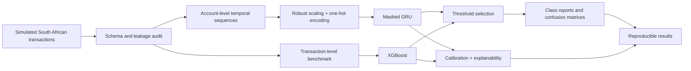
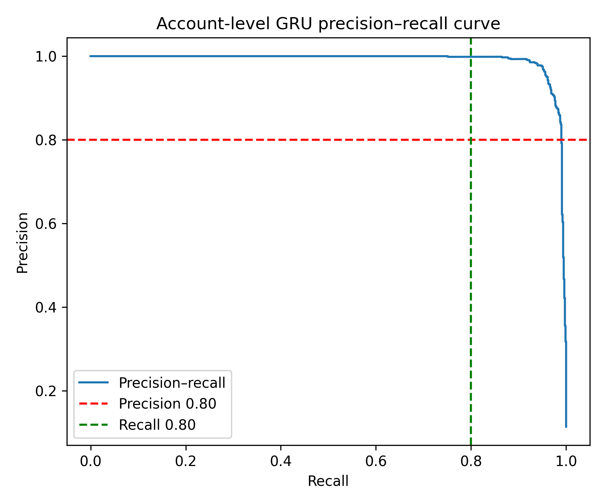
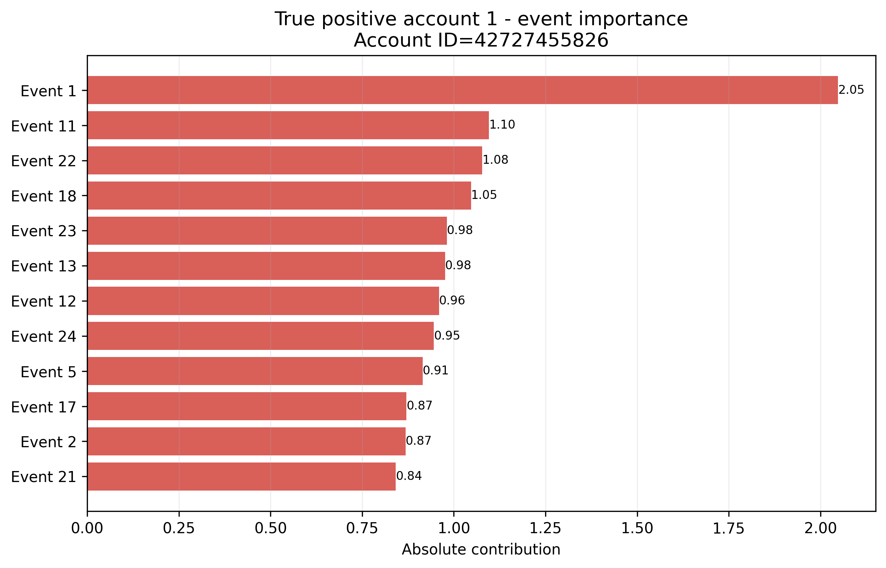
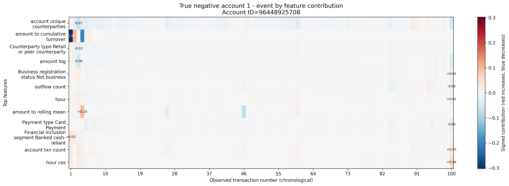
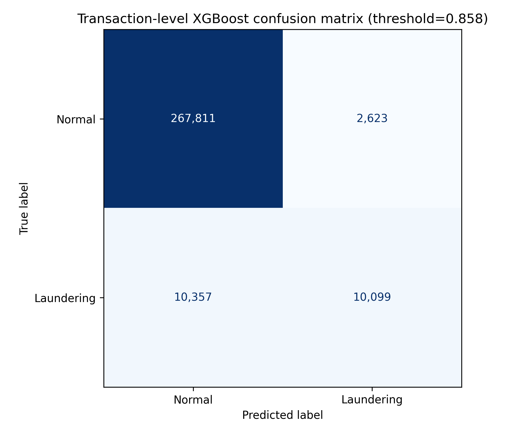
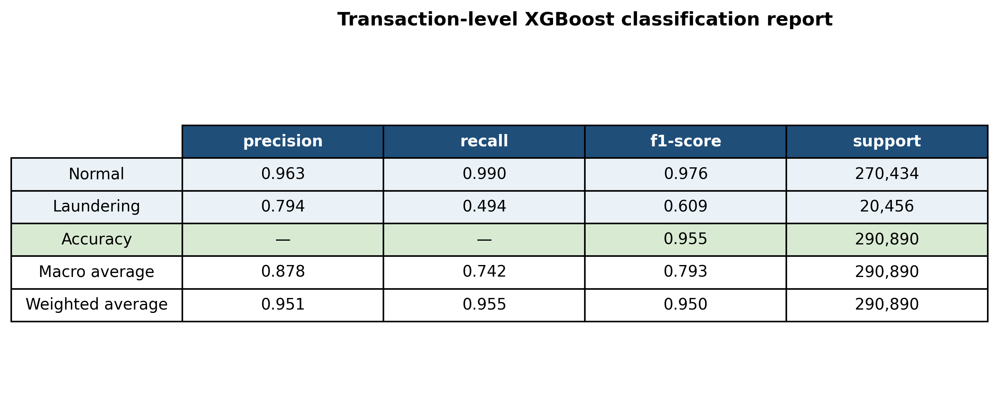
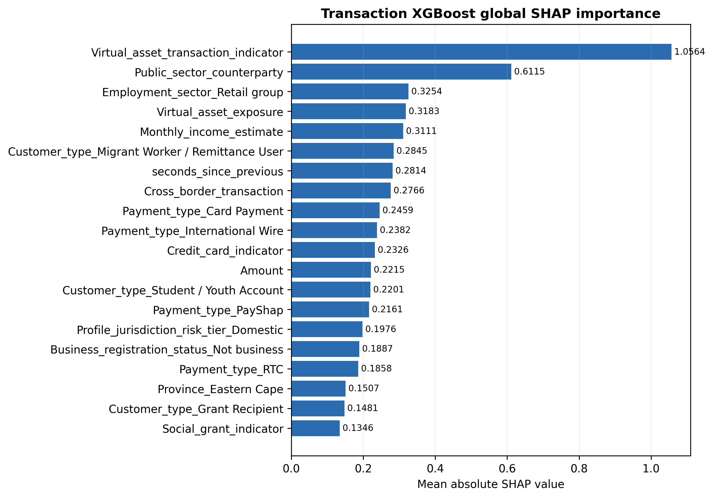

# SA-AML Sequence Intelligence

Reproducible research code for leakage-controlled anti-money-laundering (AML) detection using South African synthetic transaction data. The repository brings together account-level sequential modelling, transaction-level benchmarking, probability calibration, local and global explainability, and evaluation artefacts in one auditable workflow.

> **Repository scope:** this is the modelling and reproducibility repository. Manuscripts, conference submissions, journal papers, LaTeX sources, cover letters, and publication-specific files are intentionally excluded.

**Project name:** SA-AML Sequence Intelligence  \
**Data source:** [SA-AML-DATA-SIMULATION](https://github.com/ColbertN/SA-AML-DATA-SIMULATION)

## Why this project exists

South African AML research is constrained by the limited availability of shareable transaction data. Financial institutions cannot release customer-level histories, while public datasets rarely reflect local payment rails, currencies, jurisdictions, grants, corridor transactions, or South African financial-crime typologies. The companion simulation project therefore generates a controlled synthetic population that represents plausible South African financial behaviour while retaining labels and audit metadata for research validation.

This repository tests an important modelling question: **does an account history provide evidence that an isolated transaction model cannot see?** A transaction-level XGBoost model is retained as a benchmark, while the primary model treats an account as a time-ordered sequence of transactions. The code is designed to make leakage controls, account-level splitting, imbalance handling, threshold selection, calibration, and explanations inspectable.

## What is included

| Area | Contents |
|---|---|
| Preprocessing | Schema checks, feature selection, temporal ordering, categorical encoding, robust scaling, sequence construction and masking |
| Sequential model | Account-level gated recurrent unit (GRU), 100-event post-padded sequences, masked padding, class weighting and auxiliary event supervision |
| Transaction benchmark | XGBoost transaction classifier with account-grouped splits, imbalance weighting and threshold analysis |
| Evaluation | ROC-AUC, PR-AUC, precision, recall, F1, confusion matrices, full class reports and threshold tables |
| Calibration | Uncalibrated probabilities compared with Platt/sigmoid, beta and temperature scaling; Brier score, log loss and expected calibration error |
| Explainability | Global perturbation/SHAP summaries plus event-by-feature contribution views for representative accounts |
| Reproducibility | Small reference tables, representative figures, schemas and one-command pipeline entry points |

## Repository map

```text
.
├── README.md
├── requirements.txt
├── .gitignore
├── scripts/
│   ├── run_sequence_pipeline.py       # end-to-end account-level workflow
│   ├── run_transaction_xgb.py         # end-to-end transaction benchmark
│   ├── train_sequence_from_scratch.py
│   ├── train_transaction_xgb.py
│   ├── calibration_explainability.py
│   ├── make_sequence_figures.py
│   ├── make_event_contribution_views.py
│   ├── transaction_xgb_calibration.py
│   ├── transaction_xgb_explainability.py
│   └── ...
├── data/
│   ├── README.md
│   └── raw/SA_SAML_D_schema.json        # versioned schema; raw CSV is not committed
├── models/
│   └── README.md                        # artefact policy and loading guidance
├── results/
│   ├── README.md
│   ├── figures/                         # compact, reader-facing reference figures
│   │   ├── sequence/
│   │   └── transaction_xgb/
│   └── tables/                          # compact reference metrics
└── paper/                               # always ignored; publication work stays private
```

## End-to-end framework



## Data and provenance

The raw synthetic dataset is maintained separately in [SA-AML-DATA-SIMULATION](https://github.com/ColbertN/SA-AML-DATA-SIMULATION). It was simulated because realistic South African AML transaction histories are not openly available for research. The simulator combines publicly documented South African financial-crime patterns with locally relevant currencies, banking locations, payment channels, grant flows, corridor transactions, customer context, and typology-driven episodes.

The modelling repository does **not** commit the approximately gigabyte-scale raw CSV, generated account histories, or trained model binaries. This keeps the repository light and avoids distributing data outside its intended project location. The schema is included at [`data/raw/SA_SAML_D_schema.json`](data/raw/SA_SAML_D_schema.json), and [`data/README.md`](data/README.md) explains how to obtain and validate the data.

## Leakage control and prediction units

The target and simulator-internal fields are never used as predictive inputs. This includes laundering labels, scenario identifiers, scenario descriptions, typology labels, generated-count fields, and other fields that encode the simulator's generation decision. Account identifiers are used only to group transactions and create disjoint splits; they are not treated as ordinary numeric predictors.

The two pipelines answer different questions:

* **GRU:** “Is this account history suspicious?” Transactions are grouped by `Account_id`, sorted by the combined transaction datetime, and evaluated at account level.
* **XGBoost:** “Is this transaction suspicious?” Transactions are evaluated individually, while all rows belonging to an account remain in the same split.

This distinction prevents repeated account histories from leaking across train, validation, and test sets. Thresholds are selected on validation data and applied once to the untouched test set.

## Sequential modelling workflow

1. Build `fulldatetime` from the date and time fields.
2. Group rows by `Account_id` and order each history chronologically.
3. Create a maximum-length sequence of 100 events. Short histories are **post-padded** with `-1,000,000`, a value outside the scaled transaction range.
4. Apply a Keras masking layer so padding cannot contribute to the recurrent state.
5. Fit preprocessing objects on training accounts only: robust scaling for continuous variables and one-hot encoding for categorical variables.
6. Train the GRU with class weights and an auxiliary event-level task to improve temporal representation learning.
7. Select an operating threshold on validation data using the precision-recall trade-off, then report the frozen test metrics.

The current reference configuration uses all, inbound, and outbound sequence views, includes counterparty type, and retains 231 post-encoding input features. The full implementation is in [`scripts/train_sequence_from_scratch.py`](scripts/train_sequence_from_scratch.py).

## Results at a glance

These are compact reference snapshots generated by the current scripts. Re-run the pipelines to regenerate them for a new simulator release.

| Model | Evaluation unit | ROC-AUC | PR-AUC / average precision | Precision (laundering) | Recall (laundering) | F1 (laundering) |
|---|---:|---:|---:|---:|---:|---:|
| Masked GRU | Account | 0.9980 | 0.9906 | **0.9842** | **0.9363** | **0.9596** |
| XGBoost benchmark | Transaction | 0.9314 | 0.6965 | 0.7938 | 0.4937 | 0.6088 |

The account-level result is not directly comparable with the transaction-level result: the prediction units, class prevalence, and error costs differ. The comparison is intentional—the benchmark demonstrates why modelling transaction order and account context matters.

### Account-level GRU classification report

| Class | Precision | Recall | F1-score | Support |
|---|---:|---:|---:|---:|
| Normal | 0.9918 | 0.9981 | 0.9949 | 6,200 |
| Laundering | 0.9842 | 0.9363 | 0.9596 | 800 |
| **Accuracy** |  |  | **0.9910** | **7,000** |
| Macro average | 0.9880 | 0.9672 | 0.9773 | 7,000 |

### Calibration reference

| Method | Brier score | Log loss | ECE (10 bins) |
|---|---:|---:|---:|
| Uncalibrated | 0.00811 | 0.03291 | 0.01071 |
| Platt/sigmoid | 0.00761 | 0.02904 | 0.00384 |
| Beta | **0.00754** | **0.02893** | 0.00405 |
| Temperature | 0.00791 | 0.03162 | 0.00866 |

Calibration is reported separately from classification because a high ranking score does not automatically imply a trustworthy probability. The calibration scripts are deliberately configured without isotonic regression.

## Evaluation figures

### Sequential model

**Training behaviour and discrimination**





**Account-level errors**


**Probability calibration**


**Local explanations**

The event-by-feature views show which transactions and which features changed a prediction for representative true-positive and true-negative accounts. Padding positions are removed from the explanation plots.






### Transaction-level XGBoost benchmark








## Running the workflows

Create an environment and install the dependencies:

```bash
python -m venv .venv
source .venv/bin/activate          # Windows: .venv\Scripts\activate
pip install -r requirements.txt
```

Place the simulator's CSV at the path configured by the scripts (or update the path in one configuration location), then run:

```bash
python scripts/run_sequence_pipeline.py
python scripts/run_transaction_xgb.py
```

For inference on unseen data, use the persisted preprocessing artefacts and model loaders rather than refitting encoders or scalers. The prediction scripts document the expected feature schema and account grouping.

## Reproducibility and responsible use

* Fit scalers, encoders, calibration maps, and thresholds on training/validation data only.
* Keep account histories intact when splitting; never perform a random transaction-row split for the sequential model.
* Inspect both positive and negative class metrics. Accuracy alone is not an AML performance claim.
* Treat synthetic-data results as methodological evidence, not as production effectiveness.
* Review false negatives by typology and false positives by customer context before operational deployment.
* Do not commit raw customer data, secrets, model credentials, publication files, or generated large artefacts.

## Related project

The simulator and its schema, generation logic, audit checks, and South African typology documentation are maintained separately:

**[ColbertN/SA-AML-DATA-SIMULATION](https://github.com/ColbertN/SA-AML-DATA-SIMULATION)**

## Licence and citation

Add the project licence and preferred citation before public release. If you use this repository, cite both the modelling repository and the companion simulation repository so that the data-generation contribution remains attributable.
