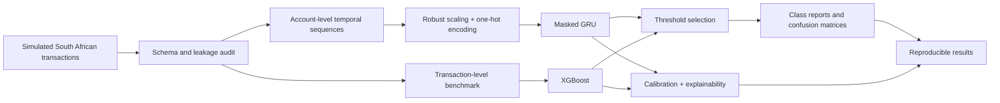
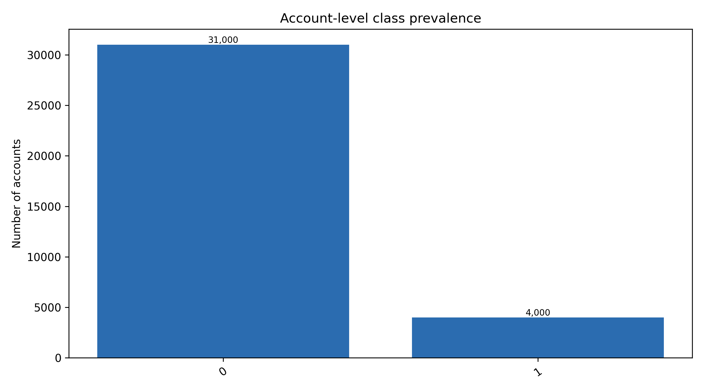
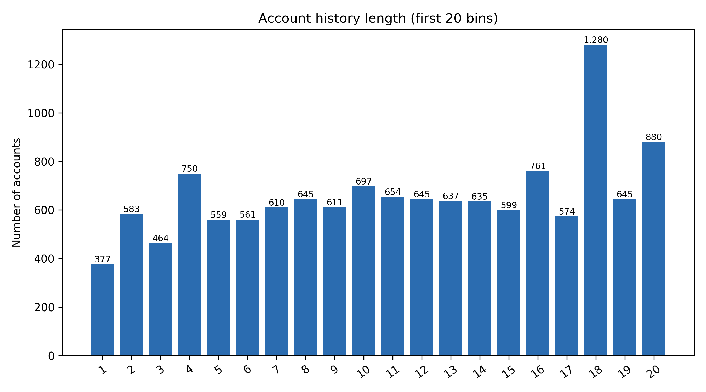
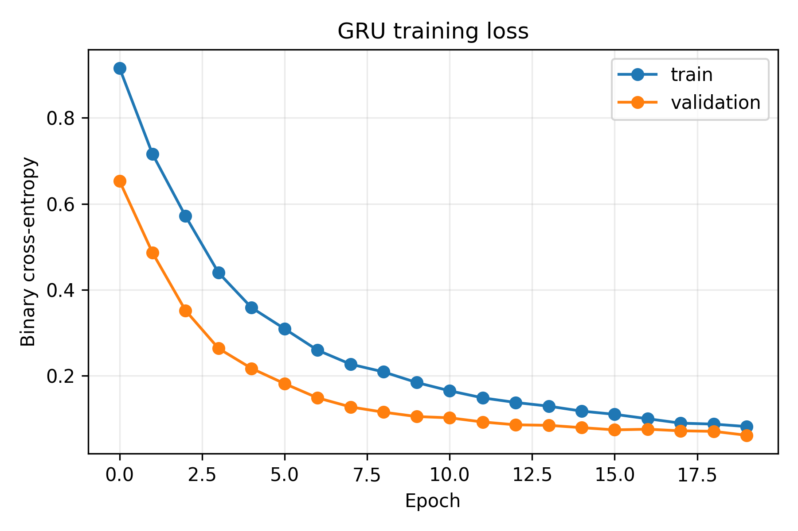
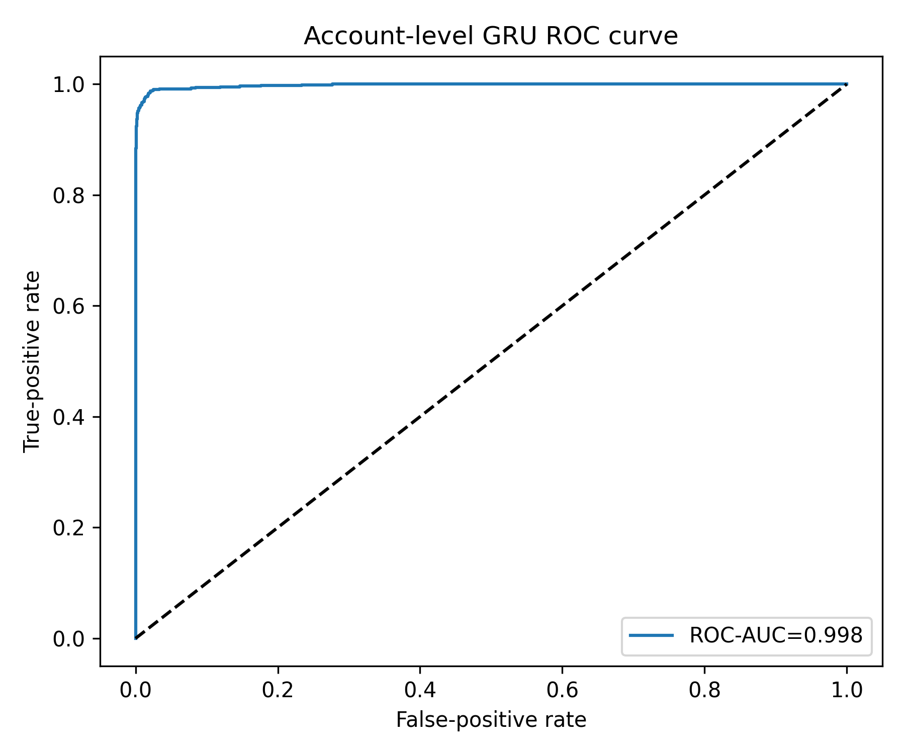
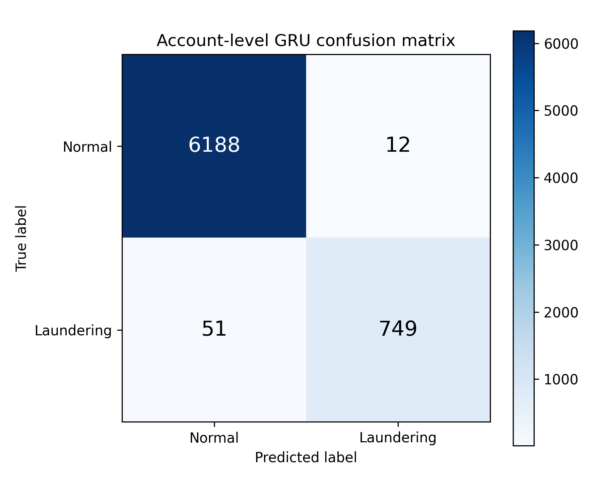
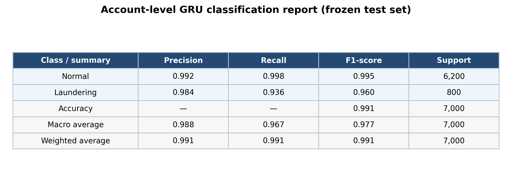
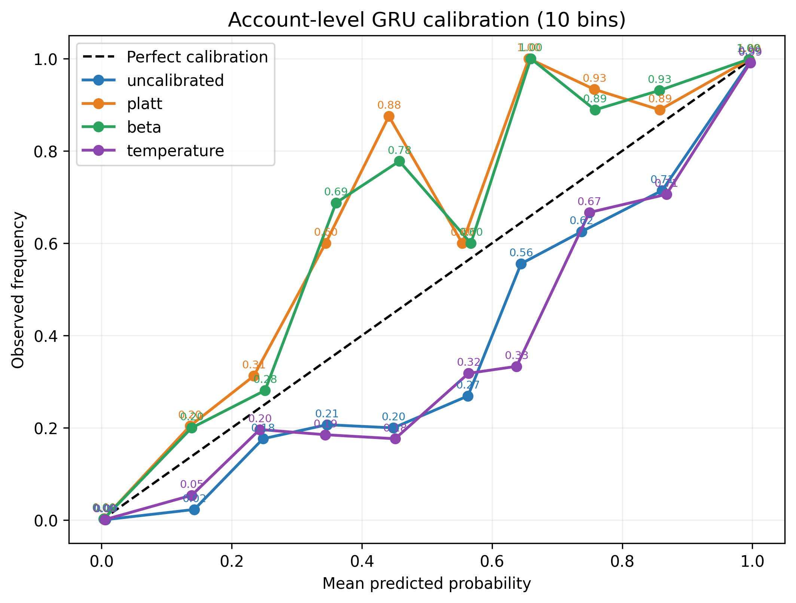
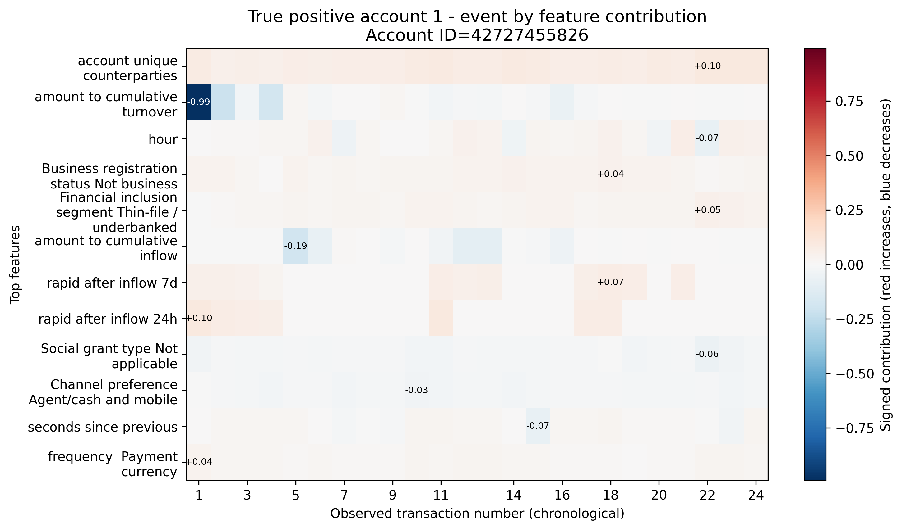
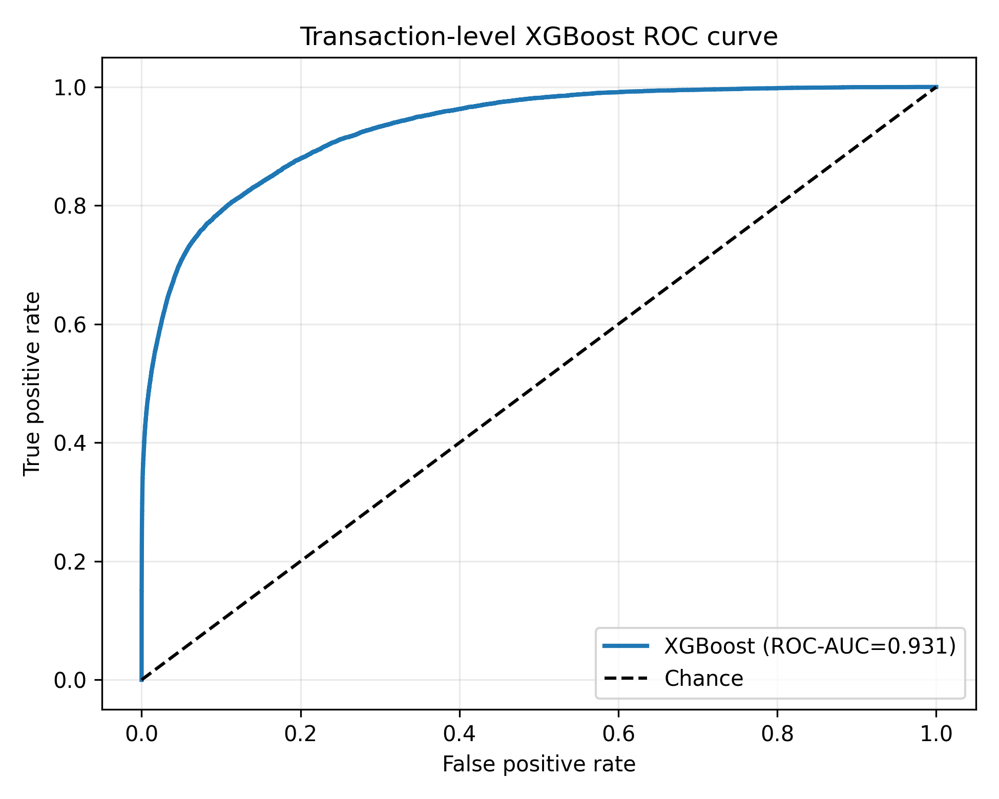

# SA-AML Sequence Intelligence

Reproducible research code for leakage-controlled anti-money-laundering (AML) detection using South African synthetic transaction data. The repository brings together account-level sequential modelling, transaction-level benchmarking, probability calibration, local and global explainability, and evaluation artefacts in one auditable workflow.

**Project name:** SA-AML Sequence Intelligence  \
**Data sources:** [SA-AML-DATA-SIMULATION repository](https://github.com/ColbertN/SA-AML-DATA-SIMULATION) · [Zenodo data record 22803333](https://zenodo.org/records/22803333)

## Why this project exists

South African AML research is constrained by the limited availability of shareable transaction data. Financial institutions cannot release customer-level histories, while public datasets rarely reflect local payment rails, currencies, jurisdictions, grants, corridor transactions, or South African financial-crime typologies. The companion simulation project therefore generates a controlled synthetic population that represents plausible South African financial behaviour while retaining labels and audit metadata for research validation.

This repository tests an important modelling question: **does an account history provide evidence that an isolated transaction model cannot see?** A transaction-level XGBoost model is retained as a benchmark, while the primary model treats an account as a time-ordered sequence of transactions. The code is designed to make leakage controls, account-level splitting, imbalance handling, threshold selection, calibration, and explanations inspectable.

## What is included

| Area | Contents |
|---|---|
| Preprocessing | Schema checks, feature selection, temporal ordering, categorical encoding, robust scaling, sequence construction and masking |
| Sequential model | Account-level gated recurrent unit (GRU), 100-event post-padded sequences, masked padding, class weighting and auxiliary event supervision |
| Transaction benchmark | XGBoost transaction classifier with account-grouped splits, imbalance weighting and threshold analysis |
| Evaluation | ROC-AUC, PR-AUC, precision, recall, F1, confusion matrices, full class reports and threshold tables |
| Calibration | Uncalibrated probabilities compared with Platt/sigmoid, beta and temperature scaling; Brier score, log loss and expected calibration error |
| Explainability | Global perturbation/SHAP summaries plus event-by-feature contribution views for representative accounts |
| Reproducibility | Small reference tables, representative figures, schemas and one-command pipeline entry points |

## Repository map

```text
.
├── README.md
├── requirements.txt
├── .gitignore
├── scripts/
│   └── run_all.py                     # single end-to-end entry point
├── src/
│   ├── validate_simulation.py         # mathematical/statistical validation
│   ├── run_sequence_pipeline.py       # account-level workflow
│   ├── run_transaction_xgb.py         # transaction-level benchmark
│   └── ...                            # internal stages and helpers
├── data/
│   ├── README.md
│   └── raw/SA_SAML_D_schema.json        # versioned schema; raw CSV is not committed
├── models/
│   └── README.md                        # artefact policy and loading guidance
├── results/
│   ├── README.md
│   ├── figures/                         # compact, reader-facing reference figures
│   │   ├── sequence/
│   │   └── transaction_xgb/
│   └── tables/                          # compact reference metrics
└── paper/                               # always ignored; publication work stays private
```

## End-to-end framework



## Data and provenance

The raw synthetic dataset is maintained separately in [SA-AML-DATA-SIMULATION](https://github.com/ColbertN/SA-AML-DATA-SIMULATION) and deposited as the citable [Zenodo record 22803333](https://zenodo.org/records/22803333). The Zenodo record is the appropriate reference for the large data release, which is intentionally not stored in this modelling repository. The dataset was simulated because realistic South African AML transaction histories are not openly available for research. The simulator combines publicly documented South African financial-crime patterns with locally relevant currencies, banking locations, payment channels, grant flows, corridor transactions, customer context, and typology-driven episodes.

The modelling repository does **not** commit the approximately gigabyte-scale raw CSV, generated account histories, or trained model binaries. This keeps the repository light and avoids distributing data outside its intended project location. The schema is included at [`data/raw/SA_SAML_D_schema.json`](data/raw/SA_SAML_D_schema.json), and [`data/README.md`](data/README.md) explains how to obtain and validate the data.

## Mathematical and statistical simulation validation

Before any classifier is fitted, [`src/validate_simulation.py`](src/validate_simulation.py) performs a model-independent validation pass. This prevents machine-learning performance from being mistaken for proof that the simulator is realistic. The validation checks population composition, missingness, account-history lengths, numeric quantiles and tails, categorical coverage, temporal inter-arrival behaviour, and optional comparisons against a reference or sampled population.

The script uses Kolmogorov--Smirnov and Wasserstein distances for numeric distributions, chi-square tests and Cramér's V for categorical distributions, account-level burstiness and inter-arrival summaries for temporal structure, and explicit checks for suspicious-only categories and negative-sampling representativeness. It writes independent figures under [`results/validation/figures/`](results/validation/figures/) and CSV, Excel, and JSON results directly under [`results/validation/`](results/validation/).

Reference outputs from the current regenerated population include 35,000 accounts, 1,441,479 transactions, 4,000 laundering accounts, 31,000 normal accounts, an 11.43% laundering-account rate, a 7.15% laundering-transaction rate, 58 columns, and zero missing cells.

### Current validation results

| Validation result | Observed value | Interpretation |
|---|---:|---|
| Transactions | 1,441,479 | Complete regenerated transaction population used for the modelling study |
| Accounts | 35,000 | Account-level grouping and sequence unit |
| Laundering accounts | 4,000 (11.43%) | Positive class remains a minority while retaining all positive accounts |
| Normal accounts | 31,000 (88.57%) | Negative class available for controlled training sampling |
| Laundering transactions | 7.15% of transactions | Suspicious activity is concentrated within account histories rather than assigned to every event |
| Missing cells | 0 | No missing values detected in the regenerated modelling-visible table |
| Payment types | 7 categories | Multiple payment rails are represented |
| Payment/received currencies | 39 categories each | Currency diversity is present; ZAR is the dominant currency (92.47%) |
| Sender/receiver bank locations | 41 categories each | Domestic and international routing categories are represented |
| Counterparty types | 17 categories | No suspicious-only category; normal-only categories are retained as a sensitivity caveat |
| Median inter-arrival time | 542,131 seconds | Account histories contain measurable temporal spacing rather than unordered rows |
| Median account burstiness | 0.042 | Temporal regularity is quantified before sequence construction |

The current run is a structural validation run, so no external-reference KS/Wasserstein or sampling-comparison p-values are shown. Those tables are generated automatically when `--reference` or `--sample` is supplied. The complete machine-readable output is available in [`validation_results.xlsx`](results/validation/validation_results.xlsx), with the individual CSV tables beside it.





The validation stage is part of exploratory analysis and must be rerun whenever the simulator release, raw data, or sampling procedure changes. It complements the later leakage audit and predictive evaluation; it does not use the target as a predictive feature.

### What the validation can prove

The tests establish **internal statistical validity**, not equivalence to undisclosed real bank data. The current run confirms that the generated population is structurally coherent, the account histories contain the intended temporal structure, and the class composition is suitable for the planned modelling task. When a reference or sampled population is supplied, the same protocol quantifies numeric and categorical distributional similarity and sampling consistency. Because no confidential South African bank reference population is available, the study does not claim exact real-world prevalence from these tests alone.

## Leakage control and prediction units

The target and simulator-internal fields are never used as predictive inputs. This includes laundering labels, scenario identifiers, scenario descriptions, typology labels, generated-count fields, and other fields that encode the simulator's generation decision. Account identifiers are used only to group transactions and create disjoint splits; they are not treated as ordinary numeric predictors.

The two pipelines answer different questions:

* **GRU:** “Is this account history suspicious?” Transactions are grouped by `Account_id`, sorted by the combined transaction datetime, and evaluated at account level.
* **XGBoost:** “Is this transaction suspicious?” Transactions are evaluated individually, while all rows belonging to an account remain in the same split.

This distinction prevents repeated account histories from leaking across train, validation, and test sets. Thresholds are selected on validation data and applied once to the untouched test set.

## Sequential modelling workflow

1. Build `fulldatetime` from the date and time fields.
2. Group rows by `Account_id` and order each history chronologically.
3. Create a maximum-length sequence of 100 events. Short histories are **post-padded** with `-1,000,000`, a value outside the scaled transaction range.
4. Apply a Keras masking layer so padding cannot contribute to the recurrent state.
5. Fit preprocessing objects on training accounts only: robust scaling for continuous variables and one-hot encoding for categorical variables.
6. Train the GRU with class weights and an auxiliary event-level task to improve temporal representation learning.
7. Select an operating threshold on validation data using the precision-recall trade-off, then report the frozen test metrics.

The current reference configuration uses all, inbound, and outbound sequence views, includes counterparty type, and retains 231 post-encoding input features. The full implementation is in [`src/train_sequence_from_scratch.py`](src/train_sequence_from_scratch.py).

## Methodology summary

This section documents exactly how fields are treated before modelling. The generated model manifest and preprocessing artefact remain the authoritative machine-readable record for a particular run; the summary below explains the design in plain language.

### Feature groups

| Feature group | Examples | Treatment | Reason |
|---|---|---|---|
| Prediction target | `Is_laundering`, `Account_is_laundering` | Excluded from inputs; retained only as labels | These define the outcome being predicted. |
| Grouping identifiers | `Account_id`, `Transaction_id`, `Sender_account`, `Receiver_account`, `Counterparty_account` | Used for grouping, ordering, joins, and split checks; not ordinary predictors | Prevents memorisation of repeated accounts and preserves the prediction unit. |
| Transaction behaviour | `Amount`, `Direction`, payment type, currencies, cross-border and SADC indicators, jurisdiction tier, social-grant and virtual-asset indicators | Numeric fields are scaled; low-cardinality categories are one-hot encoded | Represents observable transaction behaviour available to the model. |
| Customer and socioeconomic context | Income estimate, grant linkage, customer type, employment, province, age, education, inclusion segment, channel preference, business status, PEP and exposure context | Numeric fields are scaled; categorical fields are encoded or frequency encoded | Adds pre-transaction account context without using the target itself. |
| Routing and counterparty context | Bank locations, counterparty country, `Counterparty_type`, foreign-counterparty context | Encoded; high-cardinality fields use training-set frequency encoding | Retains routing information while controlling dimensionality. |
| Date/time source fields | `Date`, `Time`, `Account_open_date` | Used to derive `event_time` and account age; raw date/time columns are not predictors | Ensures chronological ordering without exposing a raw timestamp representation. |

### Explicit leakage exclusions

The primary implementation excludes simulator labels and internal generation decisions. The complete exclusion list is grouped below for readability.

| Excluded family | Fields |
|---|---|
| Target and assigned outcome | `Is_laundering`, `Account_is_laundering`, `Laundering_type` |
| AML scenario and typology | `AML_scenario_category`, `AML_scenario_code`, `AML_predicate_offence`, `AML_stage`, `AML_risk_sector`, `AML_scenario_source_keys`, `Scenario_reference_key`, `Scenario_detail`, `Scenario_label`, `Typology_stage` |
| Direct suspicion/behaviour labels | `Suspicion_indicator`, `Behaviour_component`, `Legitimate_behaviour`, `Normal_behavior_category`, `Normal_behavior_source_keys` |
| Simulator generation controls | `Opened_for_laundering_flag`, `Scenario_forced_coverage_flag`, `Account_laundering_probability`, `First_observed_transaction_date`, `Opened_during_observation_flag`, `Active_observation_days`, `Account_activity_multiplier`, `Expected_transaction_count`, `Generated_transaction_count` |
| Leakage-prone contextual fields | `Transaction_purpose_category`, `KYC_strength`, `Beneficial_ownership_opacity` |

These fields may be useful for simulator validation or post-hoc analysis, but they are not valid predictive inputs for the baseline.

`Counterparty_type` is included in the current reference experiment because the regenerated simulator does not contain a suspicious-only counterparty category. It remains a sensitivity feature and can be excluded reproducibly with `AML_INCLUDE_COUNTERPARTY=0`. Identifiers, raw date/time columns, derived event timestamps, and label columns are also removed from the ordinary feature matrix.

### Engineered features

The sequence pipeline creates behavioural features without consulting the target:

| Engineering family | Features |
|---|---|
| Temporal | `hour`, `weekday`, `month`, cyclical sine/cosine encodings, account age at event, elapsed account days, seconds since previous event |
| Amount dynamics | `amount_log`, `signed_amount`, previous amount, amount change, rolling amount mean/std, amount-to-rolling-mean, round-amount proxy |
| Flow structure | Inflow/outflow roles, inflow/outflow amounts, cumulative inflow/outflow/net flow/turnover, role counts, inflow-to-outflow ratio |
| Rapid movement | Seconds since previous inflow/outflow, rapid-after-inflow indicators for 24 hours and seven days, amount relative to cumulative flow |
| Diversity and account context | Transaction index, account transaction count, currency mismatch, unique counterparties, unique payment types, unique currencies, account amount summaries |
| Account-history aggregates | Cumulative cross-border, SADC, virtual-asset, procurement, grant, sanctions, adverse-media, public-sector, intermediary, and exposure counts/maxima |
| Categorical representations | One-hot indicators for low-cardinality categories; training-set frequency encodings for higher-cardinality currencies, locations, countries, and employment/nationality fields |

All rolling and cumulative statistics are computed within an account and ordered by `event_time`. No future account rows are used to create a preceding-event feature. The resulting account history is represented through three streams: all events, inbound events, and outbound events.

### Scaling, encoding, and masking

Continuous variables are fitted with `RobustScaler` on training accounts only, reducing sensitivity to heavy-tailed transaction amounts and extreme financial flows. Categorical variables with at most 20 training categories are one-hot encoded with `handle_unknown="ignore"`; higher-cardinality categorical variables are represented by smoothed training-set frequencies. Missing values are mapped to explicit categories or numeric zero after validation. The fitted scaler, encoder, frequency maps, feature names, padding value, and sequence key are saved together.

Each account is truncated at 100 chronological events. Short histories are post-padded with `-1,000,000`, and every recurrent stream begins with a Keras masking layer. The event auxiliary loss ignores padded labels, so artificial events cannot be learned as normal or laundering behaviour.

### Imbalance handling and split design

The account model splits unique accounts into train, validation, and test partitions before sequence construction. All transactions from an account remain in the same partition. Training retains every laundering account and samples at most three normal accounts per laundering account; validation and test populations are not resampled. The account objective applies a positive-class weighted binary cross-entropy, while the event objective masks padded positions. The XGBoost benchmark uses account-grouped partitions, training-row undersampling, and `scale_pos_weight`; it never resamples the held-out test rows.

### Hyperparameter tuning and model selection

The GRU is a controlled reference configuration rather than an unrestricted search: a 64-unit projection, bidirectional 48-unit GRU stream, Swish activations, L2 regularisation (`2e-4`), dropout, gradient clipping, Adam learning rate `3e-4`, batch size `512`, and a maximum of 20 epochs. Early stopping monitors validation account PR-AUC, and `ReduceLROnPlateau` halves the learning rate when validation PR-AUC stalls. The model checkpoint with the best validation PR-AUC is restored. The operating threshold is selected only on validation data, preferring the highest-F1 threshold that achieves at least 0.80 precision and 0.80 recall when such a point exists.

The XGBoost benchmark uses Optuna's seeded TPE sampler when `AML_XGB_TRIALS` is positive. It tunes tree count, depth, learning rate, subsampling, column sampling, child weight, gamma, L2 regularisation, and positive-class weight, maximising validation average precision with early stopping. For fast reproducible reruns, zero trials uses the recorded best fallback configuration; setting a positive trial count performs a fresh search and saves the trial table.

## Results at a glance

These are compact reference snapshots generated by the current scripts. Re-run the pipelines to regenerate them for a new simulator release.

| Model | Evaluation unit | ROC-AUC | PR-AUC / average precision | Precision (laundering) | Recall (laundering) | F1 (laundering) |
|---|---:|---:|---:|---:|---:|---:|
| Masked GRU | Account | 0.9980 | 0.9906 | **0.9842** | **0.9363** | **0.9596** |
| XGBoost benchmark | Transaction | 0.9314 | 0.6965 | 0.7938 | 0.4937 | 0.6088 |

The account-level result is not directly comparable with the transaction-level result: the prediction units, class prevalence, and error costs differ. The comparison is intentional—the benchmark demonstrates why modelling transaction order and account context matters.

### Account-level GRU classification report

| Class | Precision | Recall | F1-score | Support |
|---|---:|---:|---:|---:|
| Normal | 0.9918 | 0.9981 | 0.9949 | 6,200 |
| Laundering | 0.9842 | 0.9363 | 0.9596 | 800 |
| **Accuracy** |  |  | **0.9910** | **7,000** |
| Macro average | 0.9880 | 0.9672 | 0.9773 | 7,000 |

### Calibration reference

| Method | Brier score | Log loss | ECE (10 bins) |
|---|---:|---:|---:|
| Uncalibrated | 0.00811 | 0.03291 | 0.01071 |
| Platt/sigmoid | 0.00761 | 0.02904 | 0.00384 |
| Beta | **0.00754** | **0.02893** | 0.00405 |
| Temperature | 0.00791 | 0.03162 | 0.00866 |

Calibration is reported separately from classification because a high ranking score does not automatically imply a trustworthy probability. The calibration scripts are deliberately configured without isotonic regression.

## Evaluation figures

### Sequential model

**Training behaviour and discrimination**






**Account-level errors**





**Probability calibration**



**Local explanations**

The event-by-feature views show which transactions and which features changed a prediction for representative true-positive and true-negative accounts. Padding positions are removed from the explanation plots.




### Transaction-level XGBoost benchmark





## Running the workflows

Create an environment and install the dependencies:

```bash
python -m venv .venv
source .venv/bin/activate          # Windows: .venv\Scripts\activate
pip install -r requirements.txt
```

Place the simulator's CSV at the path configured by the scripts (or set `AML_RAW_DATA`), then run the complete workflow:

```bash
python scripts/run_all.py
```

For inference on unseen data, use the persisted preprocessing artefacts and model loaders rather than refitting encoders or scalers. The prediction scripts document the expected feature schema and account grouping.

## Reproducibility and responsible use

* Fit scalers, encoders, calibration maps, and thresholds on training/validation data only.
* Keep account histories intact when splitting; never perform a random transaction-row split for the sequential model.
* Inspect both positive and negative class metrics. Accuracy alone is not an AML performance claim.
* Treat synthetic-data results as methodological evidence, not as production effectiveness.
* Review false negatives by typology and false positives by customer context before operational deployment.
* Do not commit raw customer data, secrets, model credentials, publication files, or generated large artefacts.

## Related project

The simulator and its schema, generation logic, audit checks, and South African typology documentation are maintained separately:

**[ColbertN/SA-AML-DATA-SIMULATION](https://github.com/ColbertN/SA-AML-DATA-SIMULATION)**

The large downloadable data release is archived at **[Zenodo record 22803333](https://zenodo.org/records/22803333)**. Cite the Zenodo record when referring to the exact data release used in an experiment.

## Licence and citation

Add the project licence and preferred citation before public release. If you use this repository, cite both the modelling repository and the companion simulation repository so that the data-generation contribution remains attributable.
